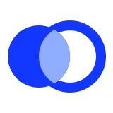
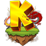
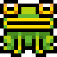

<a href="https://github.com/DenverCoder1/readme-typing-svg"></a><br />
Hey, I'm Milan 👋🏻, the founder of [Educavo](https://educavo.eu), and I'm really really passionate about what I do. I try to build things that actually solve problems, either personal ones or ones that affect a lot more people. If you want to contact me, text me on discord: `milanundso`.

```java
public class Milan extends GithubProfile {
    private boolean shouldFollow;
    private boolean shouldCheckRepositories;
    @Override
    public void onLoad(){
        this.shouldFollow = true;
        this.shouldCheckRepositories = true;
        if (this.shouldFollow && this.shouldCheckRepositories){
            System.out.println("Thanks!");
        } else {
            System.out.println("No Problem, enjoy my profile :p");
        }
    }
}
```

---

### What I'm building

&nbsp; **[Educavo](https://educavo.eu)**: an AI-powered study app for high school and university students, with a LOT of useful features like creating summaries, tests, flash cards and making studying much easier. It's my biggest project and where most of my time goes.

&nbsp; **Koid**: my own Minecraft 1.8.9 network with smooth PvP, a 1v1 practice gamemode, Hunger Games and my own "innovative" gamemode Royal Rumble. Currently Koid is in maintenance, because I am prioritizing other work, trust - one day.

&nbsp; **FrogPvP**: a German server network with SkyWars, Cores and FFA, where I work as the main developer, managing the entire technical execution.

&nbsp; **[Viron Compliance](https://viron.eco)**: I'm a developer there and mostly manage the backend to make it easier to handle customers, whilst also doing some general improvements.

---

### Tech Stack

**Languages**
<p align="center">
  <a href="https://skillicons.dev">
    <picture>
      <source media="(prefers-color-scheme: dark)" srcset="https://skillicons.dev/icons?i=kotlin%2Cjava%2Cpy%2Cts%2Cjs%2Cswift&theme=dark" />
      
    </picture>
  </a>
</p>

**Frameworks**
<p align="center">
  <a href="https://skillicons.dev">
    <picture>
      <source media="(prefers-color-scheme: dark)" srcset="https://skillicons.dev/icons?i=react%2Cnextjs%2Ctailwind%2Cspring%2Cktor%2Cfastapi&theme=dark" />
      
    </picture>
  </a>
</p>

**Databases & Infrastructure**
<p align="center">
  <a href="https://skillicons.dev">
    <picture>
      <source media="(prefers-color-scheme: dark)" srcset="https://skillicons.dev/icons?i=postgres%2Cmysql%2Cmongodb%2Credis%2Cdocker%2Cnginx%2Cgithubactions&theme=dark" />
      
    </picture>
  </a>
</p>

**LLMs**
<p align="center">
  
  
  
  
</p>

---

### Stats

<p align="center">
  
</p>

